# MediCore — Database Design

## Design Principles

1. **Every table has `organizationId`** — multi-tenant row-level isolation
2. **Every table has `createdAt` + `updatedAt`** — audit trail
3. **Soft deletes where appropriate** — patients, doctors are never hard-deleted; use `deletedAt`
4. **No nullable foreign keys where avoidable** — use explicit status fields instead
5. **CUID2 for primary keys** — collision-resistant, sortable, no sequential guessing
6. **JSONB for configuration** — `settings`, `metadata`, `formData` avoid premature column proliferation

---

## ER Diagram

```mermaid
erDiagram
    Organization {
        string id PK
        string name
        string slug UK
        enum type
        string email
        string phone
        string address
        string licenseNumber
        json settings
        enum subscriptionTier
        boolean isActive
        datetime createdAt
        datetime updatedAt
    }

    User {
        string id PK
        string email UK
        string passwordHash
        string firstName
        string lastName
        string phone
        string avatar
        boolean isActive
        boolean isEmailVerified
        string organizationId FK
        datetime lastLoginAt
        datetime createdAt
        datetime updatedAt
    }

    Role {
        string id PK
        string name UK
        string description
        enum systemRole
        string organizationId FK
        datetime createdAt
    }

    Permission {
        string id PK
        string resource
        string action
        string scope
        string description
    }

    UserRole {
        string userId FK
        string roleId FK
        datetime assignedAt
        string assignedBy FK
    }

    RolePermission {
        string roleId FK
        string permissionId FK
    }

    RefreshToken {
        string id PK
        string tokenHash UK
        string userId FK
        string sessionId
        string userAgent
        string ipAddress
        boolean isRevoked
        datetime expiresAt
        datetime createdAt
    }

    Department {
        string id PK
        string name
        string code
        string headDoctorId FK
        string organizationId FK
        boolean isActive
        datetime createdAt
    }

    Doctor {
        string id PK
        string userId FK
        string registrationNumber UK
        string specialization
        string qualification
        string departmentId FK
        string organizationId FK
        decimal consultationFee
        json availabilitySlots
        boolean isActive
        datetime createdAt
        datetime updatedAt
    }

    Staff {
        string id PK
        string userId FK
        string employeeId UK
        string designation
        string departmentId FK
        string organizationId FK
        enum shiftType
        date joiningDate
        boolean isActive
        datetime createdAt
    }

    Patient {
        string id PK
        string uhid UK
        string firstName
        string lastName
        string email
        string phone UK
        date dateOfBirth
        enum gender
        string bloodGroup
        string address
        string city
        string state
        string pincode
        string emergencyContactName
        string emergencyContactPhone
        string organizationId FK
        json metadata
        boolean isActive
        datetime deletedAt
        datetime createdAt
        datetime updatedAt
    }

    PatientDocument {
        string id PK
        string patientId FK
        string organizationId FK
        enum documentType
        string fileName
        string fileUrl
        string mimeType
        int fileSizeBytes
        datetime uploadedAt
    }

    Appointment {
        string id PK
        string appointmentNumber UK
        string patientId FK
        string doctorId FK
        string departmentId FK
        string organizationId FK
        datetime scheduledAt
        int durationMinutes
        enum type
        enum status
        string chiefComplaint
        string notes
        string roomNumber
        string referredBy
        datetime createdAt
        datetime updatedAt
    }

    MedicalRecord {
        string id PK
        string patientId FK
        string doctorId FK
        string appointmentId FK
        string organizationId FK
        string chiefComplaint
        string historyOfPresentIllness
        string pastMedicalHistory
        string examination
        string diagnosis
        string icdCode
        string plan
        string followUpInstructions
        int followUpDays
        json vitalSigns
        datetime recordedAt
        datetime createdAt
    }

    Prescription {
        string id PK
        string prescriptionNumber UK
        string patientId FK
        string doctorId FK
        string medicalRecordId FK
        string organizationId FK
        enum status
        string notes
        datetime prescribedAt
        datetime createdAt
    }

    PrescriptionItem {
        string id PK
        string prescriptionId FK
        string medicationName
        string genericName
        string strength
        string form
        string dosage
        string frequency
        string duration
        string route
        string instructions
        int quantity
        datetime createdAt
    }

    LabTest {
        string id PK
        string labOrderNumber UK
        string patientId FK
        string doctorId FK
        string appointmentId FK
        string organizationId FK
        enum status
        enum priority
        string sampleCollectedBy
        datetime sampleCollectedAt
        datetime reportedAt
        string notes
        datetime createdAt
        datetime updatedAt
    }

    LabTestItem {
        string id PK
        string labTestId FK
        string testName
        string testCode
        string category
        string result
        string unit
        string referenceRange
        boolean isAbnormal
        enum abnormalType
        string interpretation
        datetime createdAt
    }

    RadiologyOrder {
        string id PK
        string orderNumber UK
        string patientId FK
        string doctorId FK
        string organizationId FK
        string modality
        string bodyPart
        string clinicalIndication
        enum status
        enum priority
        string reportUrl
        string findings
        string impression
        string reportedBy
        datetime reportedAt
        datetime createdAt
        datetime updatedAt
    }

    Bed {
        string id PK
        string bedNumber UK
        string wardId FK
        string roomId FK
        string organizationId FK
        enum type
        enum status
        datetime createdAt
        datetime updatedAt
    }

    Ward {
        string id PK
        string name
        string code
        string departmentId FK
        string organizationId FK
        int totalBeds
        boolean isActive
        datetime createdAt
    }

    Admission {
        string id PK
        string admissionNumber UK
        string patientId FK
        string doctorId FK
        string bedId FK
        string wardId FK
        string organizationId FK
        enum status
        string admissionReason
        string diagnosis
        datetime admittedAt
        datetime dischargedAt
        string dischargeNotes
        string dischargeCondition
        datetime createdAt
        datetime updatedAt
    }

    Invoice {
        string id PK
        string invoiceNumber UK
        string patientId FK
        string appointmentId FK
        string organizationId FK
        enum status
        enum type
        decimal subtotal
        decimal discountAmount
        decimal taxAmount
        decimal totalAmount
        decimal paidAmount
        decimal balanceDue
        string currency
        string notes
        datetime dueDate
        datetime createdAt
        datetime updatedAt
    }

    InvoiceItem {
        string id PK
        string invoiceId FK
        string itemName
        string itemCode
        enum category
        int quantity
        decimal unitPrice
        decimal discountPercent
        decimal taxPercent
        decimal totalPrice
        datetime createdAt
    }

    Payment {
        string id PK
        string paymentNumber UK
        string invoiceId FK
        string patientId FK
        string organizationId FK
        decimal amount
        enum paymentMode
        string transactionId
        string referenceNumber
        enum status
        string collectedBy
        datetime paidAt
        datetime createdAt
    }

    InsuranceClaim {
        string id PK
        string claimNumber UK
        string patientId FK
        string invoiceId FK
        string organizationId FK
        string insuranceProvider
        string policyNumber
        string membershipId
        decimal claimedAmount
        decimal approvedAmount
        decimal rejectedAmount
        enum status
        string rejectionReason
        datetime submittedAt
        datetime settledAt
        datetime createdAt
        datetime updatedAt
    }

    Medication {
        string id PK
        string name
        string genericName
        string manufacturer
        string strength
        string form
        string category
        string organizationId FK
        boolean isActive
        decimal unitPrice
        datetime createdAt
        datetime updatedAt
    }

    InventoryItem {
        string id PK
        string name
        string sku UK
        string category
        string organizationId FK
        int quantityInStock
        int reorderLevel
        int reorderQuantity
        decimal unitCost
        string storageLocation
        boolean isActive
        datetime createdAt
        datetime updatedAt
    }

    Notification {
        string id PK
        string organizationId FK
        string userId FK
        string patientId FK
        enum type
        string title
        string body
        json data
        boolean isRead
        enum channel
        enum status
        string failureReason
        datetime readAt
        datetime sentAt
        datetime createdAt
    }

    AuditLog {
        string id PK
        string organizationId FK
        string userId FK
        string action
        string resource
        string resourceId
        json before
        json after
        string ipAddress
        string userAgent
        string requestId
        datetime createdAt
    }

    Organization ||--o{ User : "has"
    Organization ||--o{ Department : "has"
    Organization ||--o{ Patient : "has"
    Organization ||--o{ Appointment : "has"
    Organization ||--o{ Invoice : "has"
    Organization ||--o{ AuditLog : "generates"

    User ||--o{ UserRole : "has"
    Role ||--o{ UserRole : "assigned to"
    Role ||--o{ RolePermission : "has"
    Permission ||--o{ RolePermission : "in"

    User ||--o| Doctor : "profile"
    User ||--o| Staff : "profile"
    User ||--o{ RefreshToken : "has"

    Department ||--o{ Doctor : "has"
    Department ||--o{ Staff : "has"
    Department ||--o{ Ward : "has"

    Doctor ||--o{ Appointment : "has"
    Doctor ||--o{ MedicalRecord : "writes"
    Doctor ||--o{ Prescription : "writes"

    Patient ||--o{ Appointment : "has"
    Patient ||--o{ MedicalRecord : "has"
    Patient ||--o{ Prescription : "has"
    Patient ||--o{ LabTest : "has"
    Patient ||--o{ RadiologyOrder : "has"
    Patient ||--o{ Invoice : "has"
    Patient ||--o{ Admission : "has"
    Patient ||--o{ PatientDocument : "has"
    Patient ||--o{ InsuranceClaim : "has"

    Appointment ||--o| MedicalRecord : "generates"
    Appointment ||--o{ LabTest : "orders"
    Appointment ||--o| Invoice : "bills"

    MedicalRecord ||--o{ Prescription : "has"

    Invoice ||--o{ InvoiceItem : "contains"
    Invoice ||--o{ Payment : "receives"
    Invoice ||--o| InsuranceClaim : "has"

    Ward ||--o{ Bed : "has"
    Bed ||--o{ Admission : "used in"

    LabTest ||--o{ LabTestItem : "contains"
```



---

## Indexing Strategy

Critical indexes for performance:

```sql
-- Tenant scoping (on every major table)
CREATE INDEX idx_patients_org ON patients(organization_id);
CREATE INDEX idx_appointments_org ON appointments(organization_id);

-- Patient lookup
CREATE INDEX idx_patients_uhid ON patients(uhid);
CREATE INDEX idx_patients_phone ON patients(phone, organization_id);
CREATE UNIQUE INDEX idx_patients_uhid_org ON patients(uhid, organization_id);

-- Appointment scheduling
CREATE INDEX idx_appointments_doctor_time ON appointments(doctor_id, scheduled_at);
CREATE INDEX idx_appointments_patient ON appointments(patient_id, organization_id);
CREATE INDEX idx_appointments_status ON appointments(status, organization_id, scheduled_at);

-- Billing
CREATE INDEX idx_invoices_patient ON invoices(patient_id, organization_id);
CREATE INDEX idx_invoices_status ON invoices(status, organization_id);

-- Audit trail
CREATE INDEX idx_audit_org_time ON audit_logs(organization_id, created_at DESC);
CREATE INDEX idx_audit_resource ON audit_logs(resource, resource_id, organization_id);
```

---

## UHID Generation Strategy

Each patient gets a unique hospital ID: `MED-2024-000001`

```
Format: {prefix}-{year}-{padded 6-digit sequence per org}
Example: MED-2024-000001 (first patient in 2024)
         MED-2024-000247 (247th patient in 2024)

Stored as: uhid column (string, unique within org)
Generated by: database function or application on create
Reset: yearly or never (org-configurable)
```

Custom prefixes per organization: `APO-2024-000001` for Apollo.
